<!-- ==================== 01. CINEMATIC STUDIO HERO STAGE ==================== -->

 

<!-- ==================== 02. INTERACTIVE STUDIO DOCK ==================== -->

  &nbsp;&nbsp;&nbsp;&nbsp;&nbsp;

<!-- ==================== 03. LIVE CODE & MULTI-MODEL DAG ==================== -->

  

<!-- ==================== 04. STUDIO PILLARS & TECH STACK ==================== -->

  

<!-- ==================== 05. SPRINT MATRIX & 2026 AI INDEX ==================== -->

  

  
<b>⚡ Studio Endpoints, 2026 AI Stack &amp; Profile Engine Source · دسترسی سریع و معماری فنی</b>

   

  | Track / Portal | Endpoint | Stack &amp; Flagship Engines (2026) |
  | :--- | :--- | :--- |
  | **🌐 Main Platform** | [**navidixstudio.com**](https://navidixstudio.com) | Spatial WebGL (`Three.js` · `GSAP`), Bilingual RTL/LTR Architecture |
  | **⚡ AI Studio Workspace** | [**navidixstudio.com/studio.html**](https://navidixstudio.com/studio.html) | **444+ Active Models** · `Django` Gateway · Live OpenRouter Sync |
  | **🧠 Reasoning &amp; SWE** | [**Chat &amp; Agentic Code**](https://navidixstudio.com/studio.html) | `Claude Sonnet 5.5` · `Claude Fable 5.1` · `GPT-6 Astra` · `Gemini 4 Argon` · `DeepSeek V4.1 Flash` · `Grok 4.7` |
  | **🎨 Studio Photo &amp; Vector** | [**Image &amp; SVG Lab**](https://navidixstudio.com/studio.html#image) | `Flux 3 Image` · `Gemini Nano Banana 2.1` (Face-Lock &amp; FA Type) · `Midjourney v7` · `Recraft V4.1 Pro Vector` |
  | **🎬 Cinema &amp; Persian Voice** | [**Video &amp; Audio Studio**](https://navidixstudio.com/studio.html#video) | `Google Veo 3.1` (Lip-Sync Audio) · `Flux 3 Video` · `Kling Video O1` · `Navidix Persian TTS` |
  | **🎓 AI Production Curriculum** | [**navidixstudio.com/training.html**](https://navidixstudio.com/training.html) | 56 Interactive Modules · Field-Tested Multi-Model Workflows in Persian |
  | **🎬 Documentaries** | [**youtube.com/@navidix**](https://youtube.com/@navidix) | Independent Science, Physics, Space, History &amp; Deep-Tech Cinema |
  | **📬 Direct Contact** | [**t.me/NavidixStudio**](https://t.me/NavidixStudio) · `mohammadnavidi1380@gmail.com` | Creative Systems, Brand AI Pipelines &amp; Studio Collaborations |

  > **Code-Driven SVG Profile Engine:** Every animated stage in this profile is procedurally compiled from pure code (`CSS @keyframes` + `SVG SMIL` + `XML validation`, zero GIFs, zero third-party rate-limited widgets) via [`scripts/build-profile.ps1`](./scripts/build-profile.ps1) and [`scripts/profile-data.json`](./scripts/profile-data.json).

 

  

