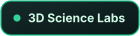
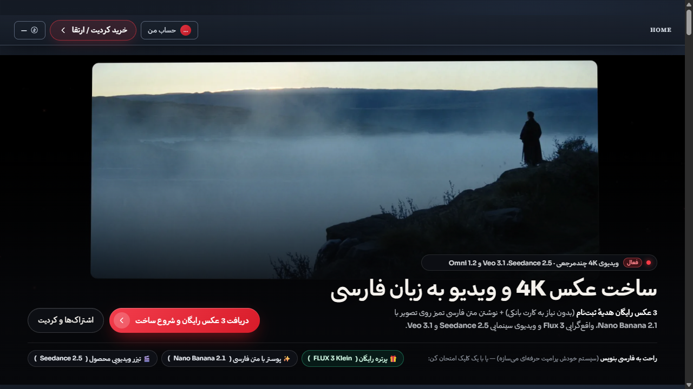
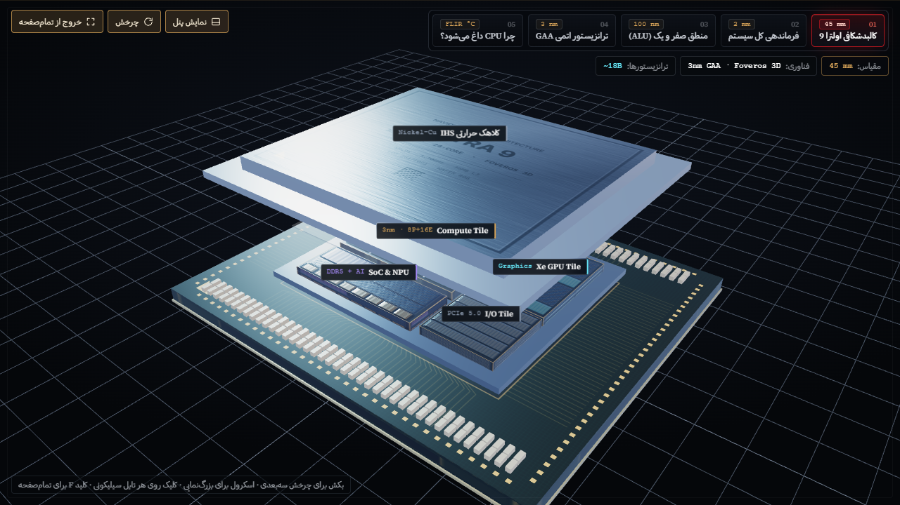
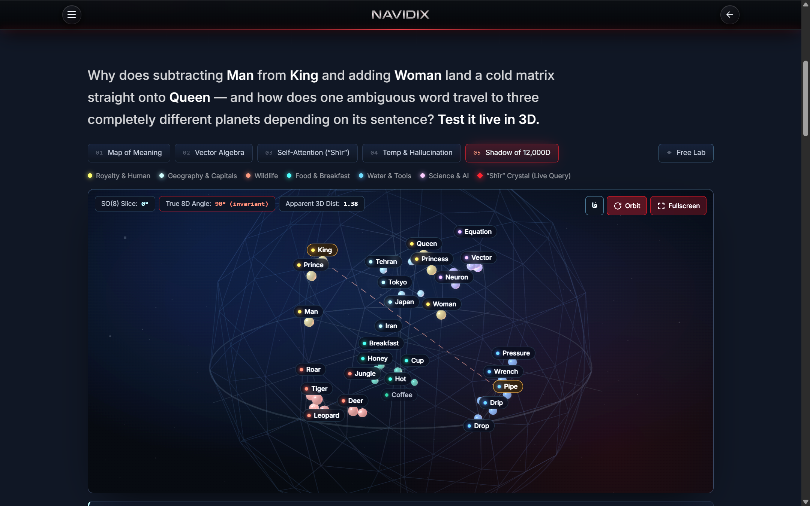
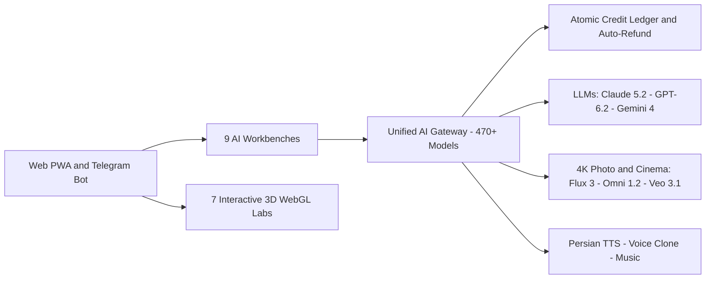

<!-- ==================== 01. CINEMATIC STUDIO HERO STAGE ==================== -->

 

<!-- ==================== 02. INTERACTIVE ACTION DOCK ==================== -->

  &nbsp;&nbsp;&nbsp;&nbsp;&nbsp;&nbsp;&nbsp;

---

## What I Built 100% Solo — An AI-Native Multimodal Operating System

I am **Mohammad Navidi**, an independent **AI-Native Full-Stack Systems Builder & Creative Technologist**. Using modern AI-assisted engineering workflows end-to-end, I architected, shipped, and operate [**Navidix Studio**](https://navidixstudio.com) completely solo — from backend provider orchestration and atomic credit accounting to a darkroom bilingual (`EN / FA`) installable PWA, a synchronized Telegram bot, and 7 interactive 3D WebGL scientific & hardware laboratories.

> **Scale Shipped Solo (Production Live):** **`470+`** Unified Frontier AI Models · **`9`** Production Workbenches · **`66`** Backend Engineering Services · **`1,880+`** Production Commits · **`7`** Zero-Build 3D WebGL Labs · **`400+`** Curated Prompts · **`27`** Visual Style Epochs

---

## Live Product Showcase

<table>
  <tr>
    <td width="50%" align="center">
      
       
      <b><a href="https://navidixstudio.com/studio.html">Navidix AI Studio OS (470+ Models · 9 Workbenches)</a></b>
       
      Chat, Voice, 4K Photo, Cinema Video, Talking Avatars, Film Room, Persian TTS, Code &amp; Agents
    </td>
    <td width="50%" align="center">
      
       
      <b><a href="https://navidixstudio.com/explore/inside-a-cpu/">Inside a 3nm CPU — Multi-Scale 3D Hardware Lab</a></b>
       
      15,000,000× zoom: Foveros 3D Chiplets → 5-Stage Pipeline → 4-Bit Silicon Adder → 3nm GAA Gate
    </td>
  </tr>
  <tr>
    <td width="50%" align="center">
      
       
      <b><a href="https://navidixstudio.com/explore/inside-a-cpu/?c=thermal">Live 48×48 2D Heat PDE &amp; Ironbow FLIR Camera</a></b>
       
      Real CMOS power physics (<code>P = α·C·V²·f + I_leak(T)·V</code>) &amp; automatic 100°C PROCHOT throttling
    </td>
    <td width="50%" align="center">
      
       
      <b><a href="https://navidixstudio.com/explore/geometry-of-meaning/">The Geometry of Meaning — 3D LLM Internals Lab</a></b>
       
      8D Word Embeddings, Vector Algebra, Live Self-Attention Rays, Softmax Temperature &amp; Top-P
    </td>
  </tr>
</table>

---

## Inside Navidix Studio — 9 Production Workbenches Built Solo

Instead of building a single-purpose wrapper, I engineered an integrated creative & reasoning operating system designed for real daily production:

| # | Workbench / System | Core Engineering & Capabilities Shipped |
| :-: | :--- | :--- |
| **01** | **Multi-Model Chat & Deep Reasoning** | 380+ frontier LLMs (`Claude Fable 5.2`, `GPT-6.2 Astra`, `Gemini 4 Neon`, `Gemini 4 Carbon`, `DeepSeek V4.1`, `Grok 4.7`), live web search citations, pinned conversations, message minimap rail, multimodal file & vision pipelines |
| **02** | **Real-Time Voice Assistant** | Low-latency conversational voice workspace integrated directly into the studio cockpit |
| **03** | **Cinema, Image & Video Production Suite** | Full project/folder organization (`Characters`, `Shots`, `Visual Styles`), **Film Room**, **AI Video Editor**, **Talking Avatar Studio**, **4K AI Upscaler**, **Logo Motion Studio**, bilingual prompt enhancer, face-lock (`Nano Banana 2.1`, `Flux 3`), 4K cinema video (`Gemini Omni 1.2 Flash`, `Seedance 2.0`, `Google Veo 3.1`, `Flux 3 Video`, `Kling`) & editable vector `SVG` (`Recraft V4.1 Pro Vector`) |
| **04** | **Audio, Persian TTS & Music Studio** | Natural Persian text-to-speech, voice cloning workflows, Foley/SFX & AI music synthesis |
| **05** | **Live Code & Website Builder** | Interactive code & web application builder with starter templates and live preview |
| **06** | **Autonomous AI Agents** | Multi-step agentic workflows for research, content pipelines, and creative automation |
| **07** | **Multi-Provider Gateway & Atomic Ledger** | Automated provider routing, health probing, live catalog sync, dynamic pricing, atomic credit reservation with automatic refund on failed generations, subscriptions + permanent credits |
| **08** | **Synchronized Telegram Ecosystem** | Native Telegram studio bot ([`@navidix_bot`](https://t.me/navidix_bot)) sharing live wallet state and instant mobile generation |
| **09** | **Interactive 3D Science Platform & Media** | **7 zero-build Three.js WebGL interactive laboratories** ([`/explore/`](https://navidixstudio.com/explore/)), **400+ tested prompts**, **27 art-history visual styles timeline**, deep technical benchmarks & science documentaries |

---

## High-Level System Architecture

<!-- ==================== 03. LIVE CODE & MULTI-MODEL DAG ==================== -->

  

<!-- ==================== 04. STUDIO PILLARS & TECH STACK ==================== -->

  

<!-- ==================== 05. SPRINT MATRIX & 2026 AI INDEX ==================== -->

---

## Open to High-Impact Collaborations & Opportunities

I love building ambitious, high-craft AI products, creative tools, and interactive WebGL experiences at extreme velocity. If you are a **founder, CTO, AI lab, creative-tech studio, or investor** interested in collaborating, partnering, or exploring what we can build together:

- **Direct Email:** [`mohammadnavidi1380@gmail.com`](mailto:mohammadnavidi1380@gmail.com)
- **X (Twitter):** [`@Navidixx`](https://x.com/Navidixx)
- **LinkedIn:** [`Mohammad Navidi`](https://www.linkedin.com/in/mohammad-navidi-7b8b75381)
- **Live Platform:** [`navidixstudio.com`](https://navidixstudio.com) · **Telegram Channel:** [`@NavidixMedia`](https://t.me/NavidixMedia)

---

## معرفی فارسی — ساخته‌شده ۱۰۰٪ تکی با معماری بومی هوش مصنوعی

من **محمد نویدی** هستم؛ بنیان‌گذار و معمار [**استودیو نویدیکس**](https://navidixstudio.com). تمام این زیست‌بوم — از بک‌اند مسیریابی و حسابداری اتمی کردیت تا فرانت‌اند دوزبانه‌ی PWA، ربات همگام تلگرام و ۷ آزمایشگاه سه‌بعدی تعاملی — را **به‌صورت یک‌نفره** و با تکیه بر جریان کار مهندسی هوش‌مصنوعی‌محور طراحی، پیاده‌سازی و روی سرور زنده مستقر کرده‌ام.

- **استودیو یکپارچه‌ی هوش مصنوعی (۴۷۰+ مدل فعال در ۹ میزکار تخصصی):** دستیار صوتی زنده، گفت‌وگو و استدلال عمیق (`Claude Fable 5.2`، `GPT-6.2 Astra`، `Gemini 4 Neon`، `Gemini 4 Carbon`، `DeepSeek V4.1`)، استودیو کامل تصویر و ویدیوی 4K شامل **اتاق فیلم، تدوین، آواتار سخنگو، آپ‌اسکیل 4K و لوگوموشن** (`Flux 3`، `Nano Banana 2.1`، `Gemini Omni 1.2 Flash`، `Seedance 2.0`، `Veo 3.1`، `Recraft V4.1 SVG`)، استودیو صدا و گویندگی فارسی، کد و سایت‌ساز و ایجنت‌های خودمختار.
- **پلتفرم علمی تعاملی سه‌بعدی ([`navidixstudio.com/explore/`](https://navidixstudio.com/explore/)):** ۷ آزمایشگاه زنده‌ی WebGL/Three.js بدون نیاز به بیلد خارجی — از جمله **درون یک پردازنده‌ی ۳ نانومتری (با دوربین حرارتی زنده‌ی FLIR و ترانزیستور GAA)** و **هندسه‌ی معنا (مکانیسم توجه و ریشه‌ی توهم هوش مصنوعی)**.
- **آموزش، پژوهش و مستندسازی:** بیش از ۴۰۰ پرامپت آزموده‌شده، خط زمان ۲۷ مکتب هنری، بنچمارک‌های تخصصی مدل‌های ۲۰۲۶ و مستندهای علمی-فناوری در یوتیوب ([`@navidix`](https://youtube.com/@navidix)).

 

  

