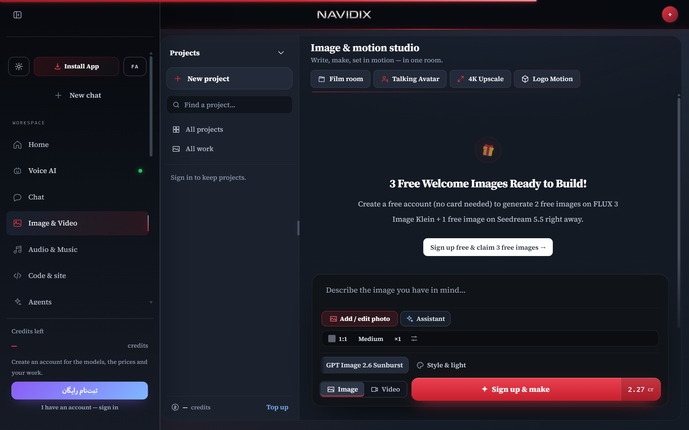
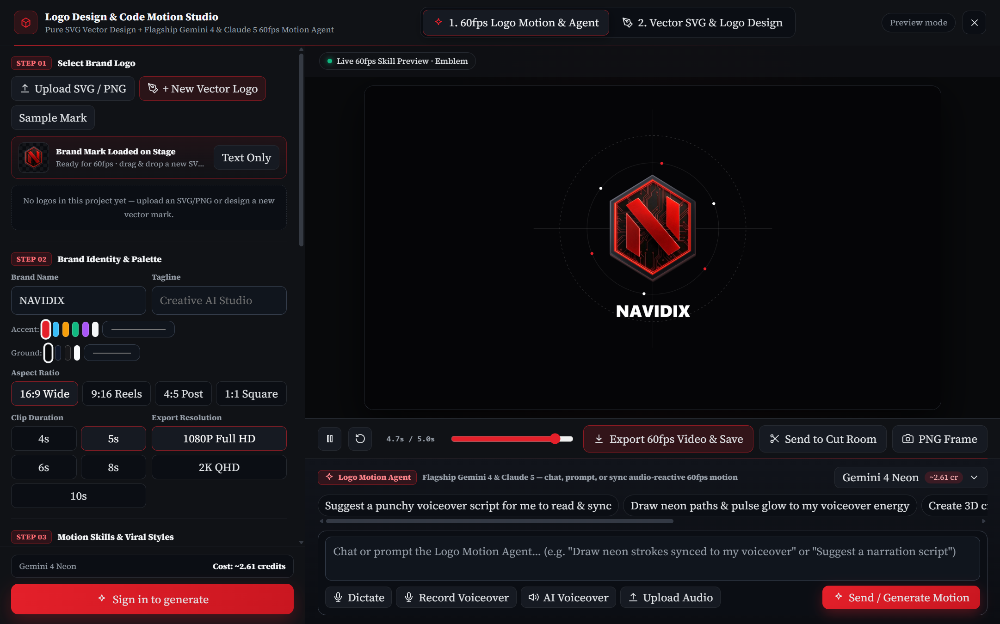
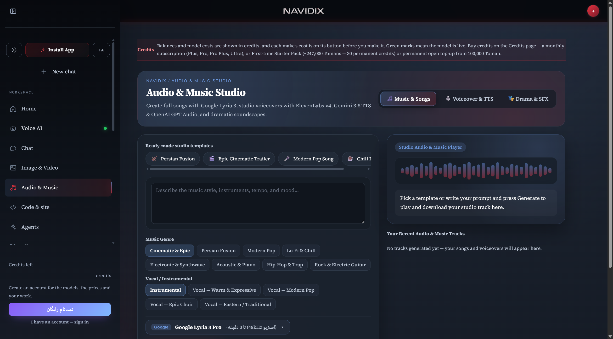
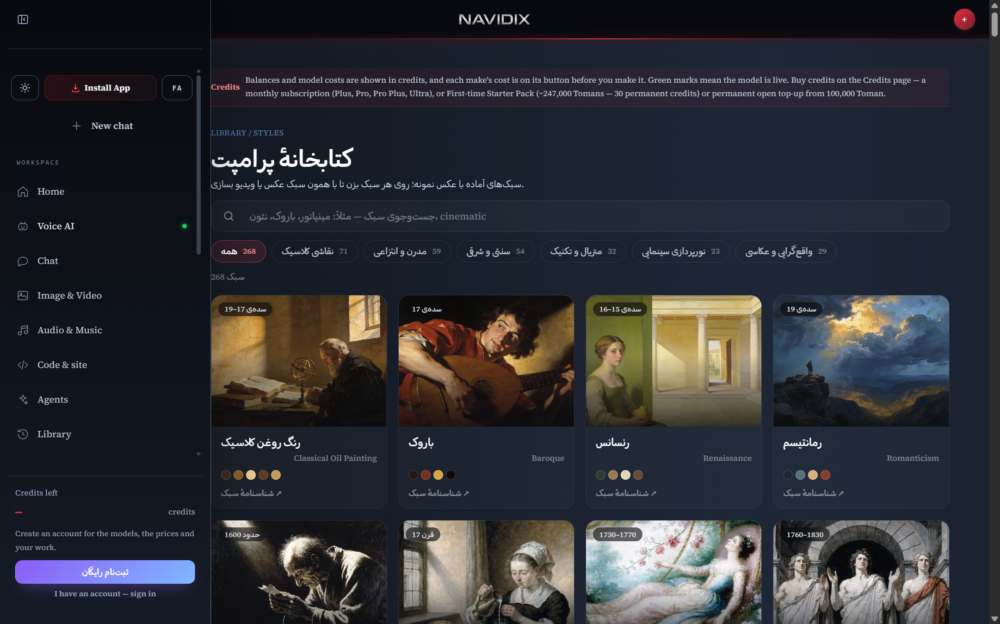
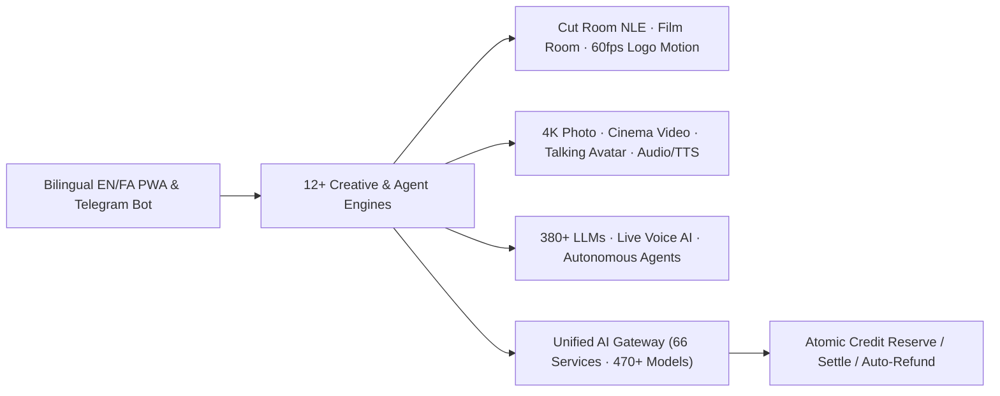

<!-- ==================== 01. CINEMATIC STUDIO HERO STAGE ==================== -->

 

<!-- ==================== 02. INTERACTIVE ACTION DOCK ==================== -->

  &nbsp;&nbsp;&nbsp;&nbsp;&nbsp;&nbsp;&nbsp;

---

## What I Spent Months Building 100% Solo — The Navidix Studio AI Ecosystem

I am **Mohammad Navidi**, Founder & Solo Systems Architect of [**Navidix Studio**](https://navidixstudio.com) — a live, commercial, full-stack **Multimodal AI Creative Operating System** built completely solo from the ground up.

Instead of shipping a thin single-model chat wrapper, I spent months engineering a real end-to-end production studio unifying **470+ frontier AI models** across **12+ browser-native engines**, **66 modular backend services**, an **atomic zero-loss credit ledger**, a **bilingual (`EN / FA`) installable PWA**, and a **synchronized Telegram bot (`@navidix_bot`)**.

> **Live Production Scale Shipped Solo:** **`470+`** Unified Frontier Models · **`12+`** Creative & Agent Engines · **`66`** Backend Services · **`1,880+`** Production Commits · **`398`** Curated Visual Styles · **Bilingual `EN / FA` PWA + Telegram Bot**

---

## Inside Navidix Studio — Live Product Showcase

<table>
  <tr>
    <td width="50%" align="center">
      
       
      <b><a href="https://navidixstudio.com/studio.html#create">Image &amp; Motion Cinema Studio (4K)</a></b>
       
      Structured Projects, Film Room, Multi-Track Cut Room, Talking Avatar, 4K Upscale &amp; Face-Lock
    </td>
    <td width="50%" align="center">
      
       
      <b><a href="https://navidixstudio.com/studio.html#create">60fps Code Logo Motion &amp; Vector SVG Studio</a></b>
       
      AI Motion Agent (Gemini 4 Neon / Claude 5), audio-reactive voiceover sync, 60fps HD/2K export &amp; Cut Room bridge
    </td>
  </tr>
  <tr>
    <td width="50%" align="center">
      
       
      <b><a href="https://navidixstudio.com/studio.html#audio">Audio, Music &amp; Persian TTS Studio</a></b>
       
      Google Lyria 3 Pro 48kHz songs, ElevenLabs v4, Gemini 3.8 TTS, OpenAI GPT Audio &amp; Drama/SFX
    </td>
    <td width="50%" align="center">
      
       
      <b><a href="https://navidixstudio.com/studio.html#prompts">Visual Styles &amp; Lighting Engine (398 Styles)</a></b>
       
      Art-history eras, cinema lighting setups, palette swatches &amp; 1-click prompt injection across image/video models
    </td>
  </tr>
</table>

---

## Core Engines & Creative Features Engineered Solo

Every week I publish an **Engineering Feature Spotlight** inside [**`NavidixStudio/navidix-studio`**](https://github.com/NavidixStudio/navidix-studio) breaking down one flagship module we shipped:

| # | Studio Engine / System | Real Production Capabilities Built Solo |
| :-: | :--- | :--- |
| **01** | **In-Browser Multi-Track NLE Video Editor (`Cut Room`)** | Full browser-native timeline editor for cutting, sequencing AI shots, transitions, audio/narration tracks, synced subtitles, and final video export — no desktop NLE required |
| **02** | **Film Room & Storyboard Continuity** | Multi-shot cinema production room with structured `Projects → Characters / Shots / Visual Styles` folders, start/end keyframe transitions, and character identity preservation across scenes |
| **03** | **60fps Logo Design & Code Motion Studio** | Dual-mode studio combining pure SVG vector emblem generation (`Recraft V4.1 Pro Vector`) with an AI-directed **60fps procedural motion engine** (`Gemini 4 Neon` / `Claude 5`), audio-reactive voiceover sync, 1080p/2K export & 1-click *Send to Cut Room* |
| **04** | **4K Cinema, Image, Talking Avatar & Upscaler** | Unified 4K production console across `FLUX 3 Image & Video`, `GPT Image 2.6 Sunburst`, `Nano Banana 2.1` (face-lock & Persian typography), `Google Veo 3.1`, `Seedance 2.0`, `Gemini Omni 1.2 Flash`, `Kling v3.0`, plus dedicated **Talking Avatar** lip-sync & **4K AI Upscaler** rooms |
| **05** | **Audio, Music & Persian TTS Suite** | Full stereo song synthesis (`Google Lyria 3 Pro`), studio voiceover (`ElevenLabs v4`, `Gemini 3.8 TTS`, `OpenAI GPT Audio`, `Navidix Persian TTS`), voice cloning & dramatic Foley/SFX |
| **06** | **Multi-Model Chat, Live Voice AI & Minimap** | Unified switching across 380+ LLMs (`Claude Fable 5.2`, `GPT-6.2 Astra`, `Gemini 4 Neon`, `Gemini 4 Carbon`, `DeepSeek V4.1`, `Qwen4 Max`, `Grok 4.7`), live web search citations, vertical message minimap, multimodal vision/docs & real-time conversational **Voice AI** |
| **07** | **Autonomous AI Agents, Code Builder & Connectors** | Persistent multi-step agent workspaces that research, draft, generate media, build live code/websites, file assets directly into projects, and connect to external publishing destinations |
| **08** | **Unified 470+ Model Gateway & Atomic Ledger** | 66 modular backend services: automated multi-provider normalization, live catalog sync, health probing, async render queue, **atomic credit reserve → settle → automatic refund on upstream failures**, subscriptions + permanent balance, and `Cmd+K` global command palette |
| **09** | **Synchronized Telegram Bot & Bilingual PWA** | Native mobile studio inside Telegram ([`@navidix_bot`](https://t.me/navidix_bot)) sharing the exact same live wallet and asset history as the installable `EN / FA` PWA *(plus a side collection of interactive educational demos at [`/explore/`](https://navidixstudio.com/explore/))* |

---

## Featured Public Repositories

| Repository | Focus | What's Inside |
| :--- | :---: | :--- |
| [**`NavidixStudio/navidix-studio`**](https://github.com/NavidixStudio/navidix-studio) | `Flagship Ecosystem` | Full visual product tour, system architecture, 1,880+ solo commit milestones & **Weekly Engineering Feature Spotlights** |
| [**`NavidixStudio/awesome-ai-cinema-prompts-2026`**](https://github.com/NavidixStudio/awesome-ai-cinema-prompts-2026) | `MIT · Prompts` | Production-tested Nov 2026 cinema, 4K photo, SVG & coding prompt blueprints + 398-style visual taxonomy |
| [**`NavidixStudio/NavidixStudio`**](https://github.com/NavidixStudio/NavidixStudio) | `Automation` | Animated SVG studio profile compiler & GitHub Actions telemetry workflow |

---

## High-Level Ecosystem Architecture

<!-- ==================== 03. LIVE CODE & MULTI-MODEL DAG ==================== -->

  

<!-- ==================== 04. STUDIO PILLARS & TECH STACK ==================== -->

  

<!-- ==================== 05. SPRINT MATRIX & 2026 AI INDEX ==================== -->

---

## Connect & Collaborate

Built solo with relentless focus on real product depth, shipping velocity, and visual craft. Open to **global collaborations, creative-tech roles, AI product advisory, and strategic partnerships**:

- **Live Platform:** [`navidixstudio.com`](https://navidixstudio.com) · **AI Studio:** [`navidixstudio.com/studio.html`](https://navidixstudio.com/studio.html)
- **Direct Email:** [`mohammadnavidi1380@gmail.com`](mailto:mohammadnavidi1380@gmail.com)
- **X (Twitter):** [`@Navidixx`](https://x.com/Navidixx) · **LinkedIn:** [`Mohammad Navidi`](https://www.linkedin.com/in/mohammad-navidi-7b8b75381)
- **YouTube:** [`@navidix`](https://youtube.com/@navidix) · **Telegram:** [`@NavidixMedia`](https://t.me/NavidixMedia) · **Bot:** [`@navidix_bot`](https://t.me/navidix_bot)

---

## معرفی فارسی — اکوسیستم کامل استودیو نویدیکس (ساخته‌شده ۱۰۰٪ تکی)

من **محمد نویدی** هستم؛ بنیان‌گذار و معمار [**استودیو نویدیکس**](https://navidixstudio.com). ماه‌ها زمان و انرژی اصلی‌ام را صرف طراحی، مهندسی و راه‌اندازی کامل یک **سیستم‌عامل تولید محتوا و هوش مصنوعی چندرسانه‌ای** به‌صورت یک‌نفره کرده‌ام:

- **۴۷۰+ مدل هوش مصنوعی در ۱۲+ موتور تخصصی درون مرورگر:** تدوینگر ویدیوی چندلایه (**Cut Room NLE**)، **اتاق فیلم (Film Room)** برای کارگردانی چندشاته و ثبات کاراکتر، **استودیو لوگوموشن ۶۰ فریم و وکتور SVG** (با ایجنت هوشمند و همگام‌سازی صدا)، **آواتار سخنگو**، **آپ‌اسکیل 4K**، **استودیو صدا و موسیقی** (`Lyria 3 Pro`، `ElevenLabs v4`، گویندگی فارسی و افکت صوتی)، **گفت‌وگو با ۳۸۰+ مدل متنی و دستیار صوتی زنده**، **کد و سایت‌ساز** و **ایجنت‌های خودمختار**.
- **معماری بک‌اند و زیرساخت تجاری (۶۶ سرویس):** مسیریابی هوشمند چندارائه‌دهنده، صف رندر موازی، دفترکل اتمی کردیت با بازگشت خودکار وجه در خطاها، اپلیکیشن PWA دوزبانه‌ی فارسی/انگلیسی و ربات همگام تلگرام (`@navidix_bot`).
- **کتابخانه‌ی ۳۹۸ سبک بصری و پرامپت‌های حرفه‌ای:** انتخاب یک‌کلیکه‌ی سبک نورپردازی و مکاتب هنری در [`navidixstudio.com/prompts.html`](https://navidixstudio.com/prompts.html) *(در کنار بخش آموزشی و آزمایشگاه‌های تعاملی [`/explore/`](https://navidixstudio.com/explore/))*.

 

  

